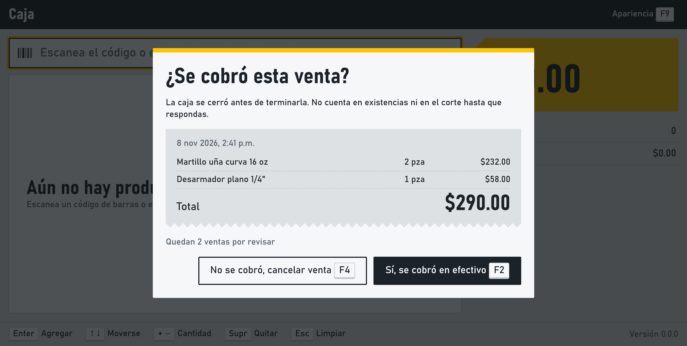
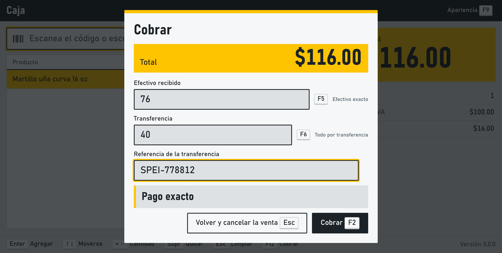

# Register app

Desktop register built with Electron, React, and TypeScript, using [electron-vite](https://electron-vite.org/) on top of Vite. It keeps its local database up to date and rings up a sale from the keyboard: a scan or a search by name adds a product and updates the totals with VAT. F12 collects the sale with cash, a transfer, or both, shows the change, and prints the ticket. A sale left unfinished by a power cut comes back when the register starts. The real drawer and card terminal arrive in the next tasks of the [roadmap](../../docs/plan/04-roadmap.md).

Electron 45 runs on Windows 10 and later, which covers the machines of [ADR 0002](../../docs/adr/0002-caja-electron.md).

## Layout
| Path | Contents | Where it runs |
| --- | --- | --- |
| `src/main/` | Window, navigation limits, answers to the screen, and the local database | Main process, with Node |
| `src/main/hardware/` | Device interfaces, and their fakes in `fakes/` | Main process, with Node |
| `src/main/checkout/` | Checkout, which drives the devices in the order of ADR 0010, and the states of a sale | Main process, with Node |
| `src/preload/` | The `window.pos` bridge | Sandboxed preload script |
| `src/renderer/` | React screen | Sandboxed renderer, without Node |
| `src/renderer/sale/` | Sale screen: lookup box, lines, totals, and scanner detection | Sandboxed renderer, without Node |
| `src/renderer/appearance/` | Dialog where the owner changes how the register looks | Sandboxed renderer, without Node |
| `src/renderer/checkout/` | Payment screen: cash received, transfer with its reference, and the change | Sandboxed renderer, without Node |
| `src/renderer/recovery/` | Dialog that asks about the sales left pending | Sandboxed renderer, without Node |
| `src/shared/` | Types and channel names used on both sides of the bridge | Compiled into each side |
| `e2e/` | Startup, database, sale, and recovery tests with Playwright, and the crash drill | Test runner, driving the built app |

## How the screen stays away from Node
- **Window:** `contextIsolation` and `sandbox` are on, and `nodeIntegration` is off. The startup test reads these settings from the running window and checks that `require` and `process` do not exist on the screen.
- **Bridge:** the screen can only call the functions of `PosApi`, and the main process rejects calls from any other page.
- **Foreign pages:** the window cannot navigate away from the register screen or open new windows, so the bridge is never offered to another site.
- **Injected code:** the Content Security Policy in `index.html` only allows scripts and styles from the app itself.
- **Compile time:** `tsconfig.web.json` has no Node types, so screen code that uses `process` or `node:fs` does not compile.
- **Imports:** `src/main/screen-boundary.test.ts` fails if any file in `src/renderer` or `src/shared` imports Electron or a file from `src/main` or `src/preload`, such as a device or its fake.

## Sale screen
The lookup box always holds the keyboard, so a scan lands there even after a click somewhere else. The decisions behind the screen are in [ADR 0024](../../docs/adr/0024-pantalla-de-venta.md).

| Key | What it does |
| --- | --- |
| Enter | Adds the product with that exact code or, for typed text, the highlighted match |
| ↑ ↓ | Moves through the matches or, with no matches, through the lines of the sale |
| + − | Adds or takes away one unit of the selected line, when the box is empty |
| Supr | Removes the selected line, when the box is empty |
| Esc | Clears the box and the matches |
| F9 | Opens the appearance dialog |

A barcode scanner acts as a keyboard, so the register tells it apart by speed: at least 4 characters with no more than 50 ms between them. Only what happens to an unknown code changes: from the scanner it shows a warning, and from a person it searches by name.

Search runs on an FTS5 index in the local database. It matches the beginning of each word and ignores accents and capitals. With 5,000 products on the development PC, adding a scanned product took 24.5 ms at the 95th percentile, against a limit of 100 ms.

Until the real catalog arrives with F0-16, the register fills an empty catalog with sample products marked `is_sample`. Their barcodes are valid EAN-13 codes that start with 2, a range reserved for use inside a store. `2000000000107` is the first one, a hammer at $116.00.

## Sale states and recovery
A sale is saved as `pending_payment` before anything is charged, so a power cut can never leave money without a record ([ADR 0010](../../docs/adr/0010-guardar-antes-de-cobrar.md)). From there it can only become `completed` or `cancelled`, and each change is one transaction. `src/main/checkout/sale-state-machine.ts` gives a clear error, and triggers in the database refuse the same changes if the code ever gets it wrong ([ADR 0025](../../docs/adr/0025-maquina-de-estados-de-la-venta.md)).

The screen sends only products, quantities, and the total the customer sees. The main process prices the sale with the catalog and saves nothing if its total is different. A pending sale counts neither in stock nor in the cash-up: the `counted_sale` view only has completed sales, and a `payment` row only exists for them.

When the register starts, it shows the sales left pending, oldest first, and does not let anyone sell until each one is answered.



| Key | What it does |
| --- | --- |
| F2 | The sale was paid. It asks how, with the same form as the payment screen, and records it |
| F4 | The sale was not paid. It stays in the database as cancelled |

The keyboard rests on the dialog rather than on a button, and Esc does nothing, so a scanner or a stray key cannot answer for the cashier.

## Payment
F12 saves the sale as pending and opens the payment screen. If the catalog changed since the cashier built the sale, nothing is saved and a warning says so. The decisions are in [ADR 0026](../../docs/adr/0026-cobro-con-efectivo-transferencia-y-mixto.md).



| Key | What it does |
| --- | --- |
| Enter | Moves to the next box. It never collects, because a scanner ends every code with Enter |
| F2 | Collects. It only works when the payments add up to the total |
| F5 | Fills the cash that the transfer leaves to pay |
| F6 | Fills the transfer that the cash leaves to pay, and moves to its reference |
| F7 | Fills the card payment that the rest leaves to pay, and moves to its folio |
| Esc | Cancels the saved sale and goes back to the products |

Transfers and cards are exact, because a bank gives no change, so the change always comes out of the cash. A card is charged on the standalone terminal, and the cashier types the folio it prints. It is recorded as `card_manual`, and a folio with 13 digits or more is refused because it could be a card number, which the register never keeps (RF-016, [ADR 0028](../../docs/adr/0028-tarjeta-tecleada-cajon-y-cantidades-medidas.md)). A cash payment is recorded for what it paid of the sale, not for what the customer handed over, so the payments of a sale always add up to its total. A transfer without its reference is refused by the screen, by the main process, and by the database. The main process works the payments out again from the saved total, so the screen cannot make a sale complete with the wrong amounts.

After collecting, the screen shows the folio and the change until the cashier presses Enter or Esc. F8 prints the last ticket again, here or on the sale screen.

## Products sold by length, weight, or volume
Choosing a product that is not sold by piece opens a quantity box with the amount of the line in view: 3.275 m of cable at $12.50 shows $40.94 before anything is added. Enter adds it, and Esc cancels. Above 50 kg, 100 m, or 50 L the box asks for F2 instead of Enter, so typing 125 for 1.25 or the Enter of a barcode scan cannot add a wrong line. New meters add to the line that already has some.

## Ticket
Every completed sale gets a short folio such as `T1-000123`, assigned inside the transaction that completes it, so cancelled sales leave no gap. The ticket shows the business, the folio, the date, each product with its quantity and unit price, the base, the VAT of each rate, the total, each payment, and the change. A reprint says REIMPRESIÓN and leaves the change out, because it is not kept ([ADR 0027](../../docs/adr/0027-ticket-escpos-y-folio-corto.md)).

The drawer hangs from the printer, so it opens only when the printer works. To print on a real printer, share it in Windows and start the register with its name:

```bash
pnpm --filter @pos-saas/pos start
```

with the variable `POS_PRINTER_SHARE` set to the shared printer, such as `\\localhost\TM-T20`. Without it the register sells normally and prints nothing, because a missing printer must never stop a sale.

## Sign in
Nothing works until a person enters with a PIN of four to eight digits, with or without internet. The first start asks for the owner. PINs are kept only as scrypt hashes, five wrong ones in a row lock that person for five minutes (the lock survives a restart), and the main process refuses sales and the catalog while nobody is signed in ([ADR 0029](../../docs/adr/0029-acceso-con-pin-y-sesion-de-caja.md)). F6 signs out.

## Cash
F3 opens everything about the cash of the register. A closed register cannot sell: it opens with a float. Entries and exits of cash need a reason, and a cashier needs the PIN of an owner to take cash out. The register warns, without stopping any sale, when the drawer passes the limit the owner set (,000 at first). The cut counts bills and coins by denomination plus the card and transfer vouchers, shows the difference of each form of payment, asks for a reason when it does not balance, and closes the session. Only the owner sees what the drawer should hold.

| Key | What it does (inside the cash dialog) |
| --- | --- |
| F5 / F6 | Cash entry / cash exit |
| F7 | The cut, which closes the register |
| F8 | Changes the withdrawal warning (owner) |
| F2 | Confirms the form that is open |

## Returns
F4 takes back what a customer returns. Type the folio of the ticket, say how much of each line comes back and why, and the screen shows what is given back by each means before confirming. The sale never changes: the return is a record next to it ([ADR 0030](../../docs/adr/0030-devoluciones-como-registro-compensatorio.md)). The owner authorizes every return, so a cashier asks for their PIN. A sale of more than 30 days, or a product sold by length or weight, is refused unless the owner overrides it. A return can never bring back more than was sold.
## Administration
F1, for the owner only, holds what is done once or rarely. **F5** loads the products and the stock that Eleventa exports as a CSV: columns are found by name, a bad row is reported with its line and reason, loading the same file twice adds nothing, and the sample products are removed. The report gives the cost of the stock loaded, to compare with Eleventa. **F6** sets up the backups: a folder or USB and a passphrase. A consistent copy of the database is encrypted with AES-256-GCM and written every hour, and the newest 48 stay. **F7** makes one now, and **F8** prepares a restore that the register applies when it starts again, keeping the old database beside it ([ADR 0031](../../docs/adr/0031-inventario-importacion-respaldo-e-instalador.md)).

Stock is the sum of an immutable ledger (stock_movement). A completed sale and a return post their movements in the same transaction, and stock can go below zero.

## Installer
`pnpm --filter @pos-saas/pos package` builds `dist/Caja Setup <version>.exe` with electron-builder (NSIS, per user, no administrator). Updating is running the new installer, and uninstalling never deletes the data. See [the installation guide](../../docs/instalacion.md), including the SmartScreen warning that an unsigned installer shows.
## Appearance
F9 opens the dialog where the owner sets the business name, one of six colors, one of three text sizes, and the light or dark theme. Changes show at once and stay only when saved, and Esc undoes them. The stylesheet takes everything from a few tokens, driven by three attributes on the page, and a test checks that the text of every color and theme keeps a contrast of at least 4.5:1.

## Hardware
The screen never gives orders to a device. It will ask the main process for a business operation, such as "check out this sale", and the main process decides which devices to use and in what order. That way the drawer cannot open for a sale that was not saved, whatever the screen does.

| Interface | What it does | Fake | What the fake records |
| --- | --- | --- | --- |
| `PrinterProvider` | Prints a job of raw ESC/POS bytes | `RecordingPrinter` | Every byte of every job, in order |
| `CashDrawer` | Opens the drawer | `RecordingCashDrawer` | How many times it opened |
| `ScaleProvider` | Reads a weight in thousandths of a kilogram | `ScriptedScale` | Returns the weights a test placed on it |
| `CardTerminal` | Charges a card and returns only the outcome, never card data | `ScriptedCardTerminal` | Each charge, once per idempotency key |

`createFakeHardware()` builds the four fakes with one shared log, so a test can check the order of a whole sale. Each fake can fail once on purpose (`failNextWith`), the way a printer without paper or a terminal without signal would.

`SaleCheckout` follows [ADR 0010](../../docs/adr/0010-guardar-antes-de-cobrar.md): it saves the sale as pending, charges the card if there is one, marks the sale completed, opens the drawer for cash, and prints the ticket. If the sale cannot be saved, nothing is charged. A declined card leaves the sale pending, so the cashier can try another method. Once the sale is completed, a failing drawer or printer becomes a problem to show, never an error, so the screen cannot mistake a completed sale for a failed one and charge again.

The register runs `SaleCheckout` through the bridge (`checkoutSale`). The ticket printer is real when `POS_PRINTER_SHARE` is set (`WindowsSharedPrinter`), and the cash drawer opens through that printer with an ESC/POS pulse after a cash sale is saved. Without the variable both are fakes. A USB scale would arrive with its device.

## Local database
The register keeps its data in `pos.db`, in the user data folder of the app (`%APPDATA%\@pos-saas\pos` on Windows), never in the repository. `LocalStore`, in `src/main/local-store/`, is the only code that talks to SQLite, through the `node:sqlite` module that ships with Electron ([ADR 0021](../../docs/adr/0021-sqlite-de-la-caja.md)).

- **Startup:** the main process opens the database and applies pending migrations before any window opens.
- **Durability:** WAL is required, and every commit reaches the disk before it returns (`synchronous = FULL`).
- **Migrations:** each one runs in its own transaction with the new schema version, so a failure undoes it completely. To change the schema, add an entry at the end of `MIGRATIONS`. Never edit one that has shipped.
- **After a forced close:** on Windows the shared-memory file (`-shm`) stays busy for a few seconds, so opening retries for up to 15 seconds on that exact error.
- **When it cannot open:** if a migration fails or the file comes from a newer version of the app, the register shows an error box, opens no window, and exits with code 1.

The tests never touch the real database, because each run gets a temporary user data folder.

## Commands
Run them from the repository root. The first time, Electron downloads its binary, about 150 MiB.

Build and open the register:

```bash
pnpm --filter @pos-saas/pos start
```

Open it with hot reload for development:

```bash
pnpm --filter @pos-saas/pos dev
```

Type-check, and run the Vitest tests and the Playwright startup test. The startup test opens real windows for a few seconds:

```bash
pnpm --filter @pos-saas/pos typecheck
```

```bash
pnpm --filter @pos-saas/pos test
```

Measure how fast the register adds products with a catalog of 5,000. It opens the register and prints the times:

```bash
pnpm --filter @pos-saas/pos build
```

```bash
pnpm --filter @pos-saas/pos exec playwright test sale-screen -g "under 100 ms"
```

Run the crash drill. The register opens and saves test sales to a temporary database, and the terminal prints the command to kill it. After the forced close, the drill reopens the register and reports whether any confirmed sale was lost:

```bash
pnpm --filter @pos-saas/pos crash-drill
```

## Continuous integration
The `TypeScript` job runs these tests on Linux with a virtual display (`xvfb-run`). It also lifts the Ubuntu 24.04 restriction on user namespaces, so the tests run with the sandbox of Electron on rather than with `--no-sandbox`.
