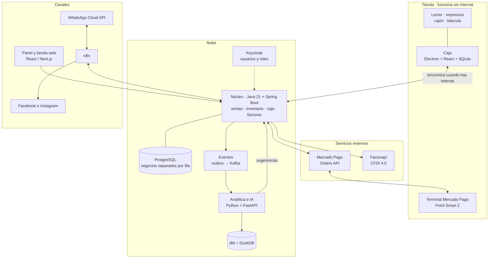
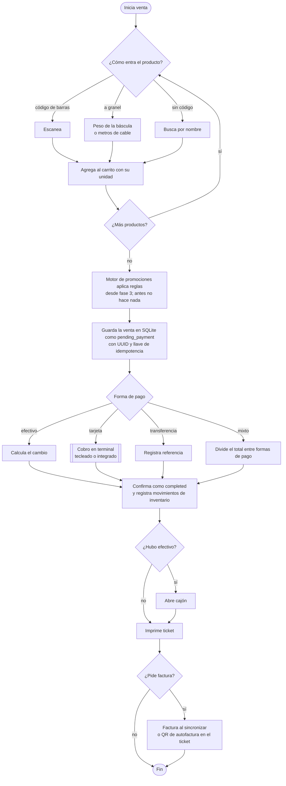
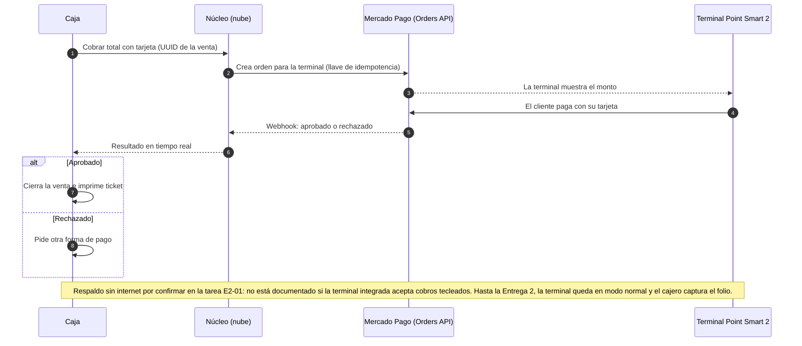
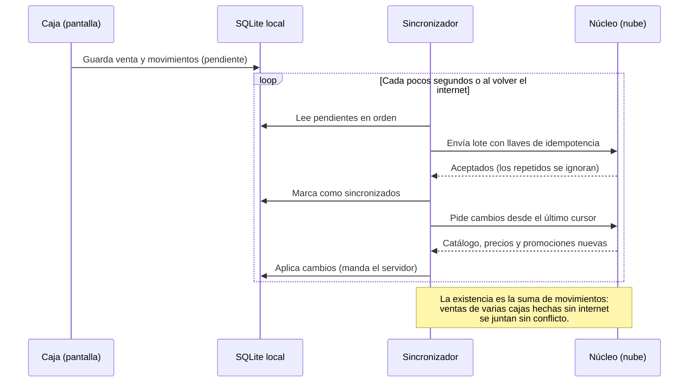
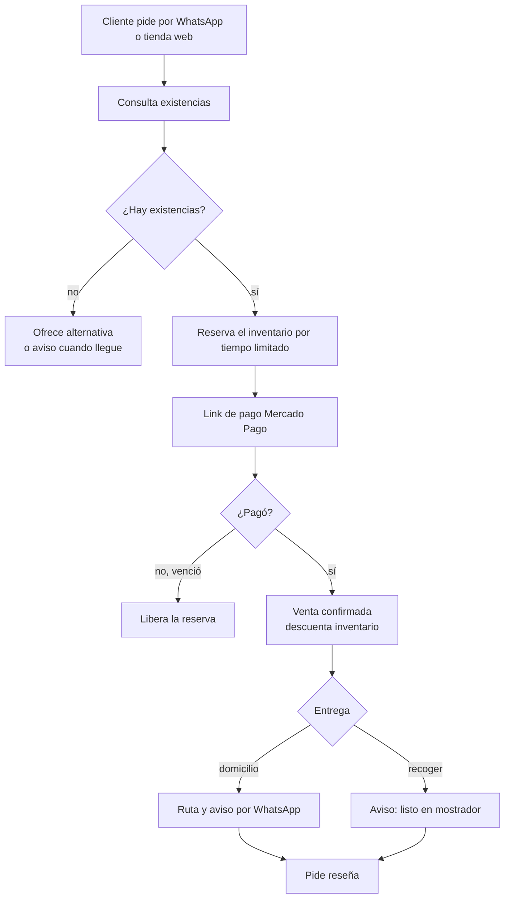
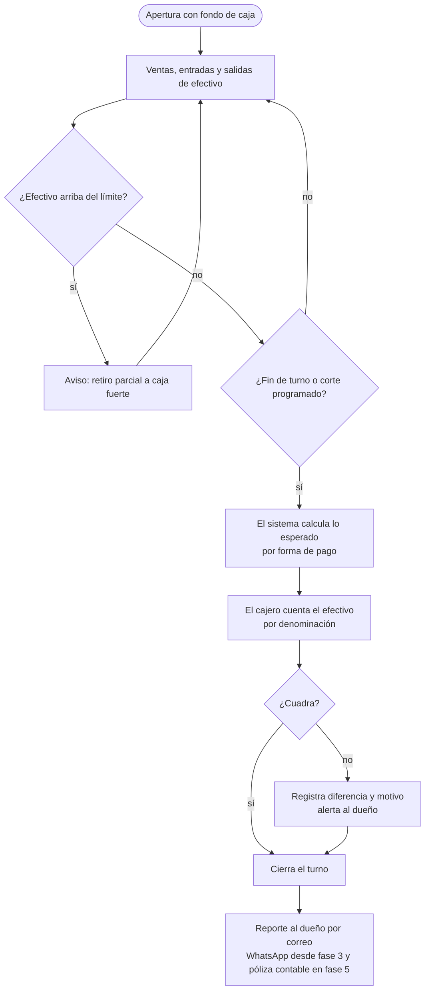
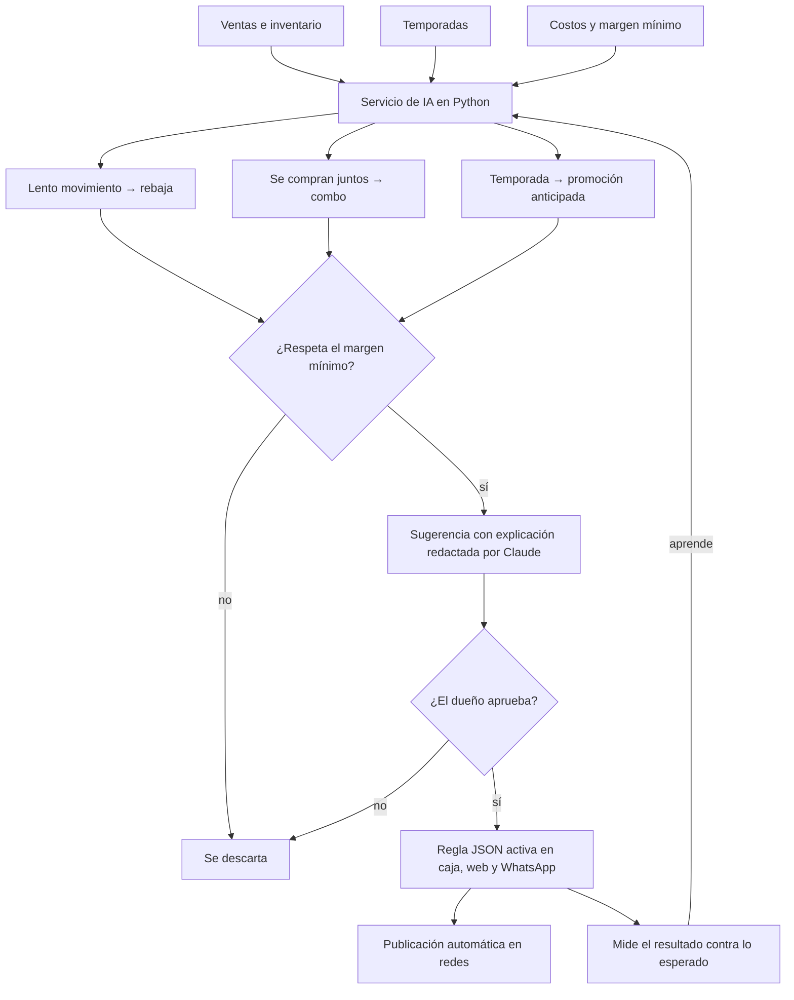
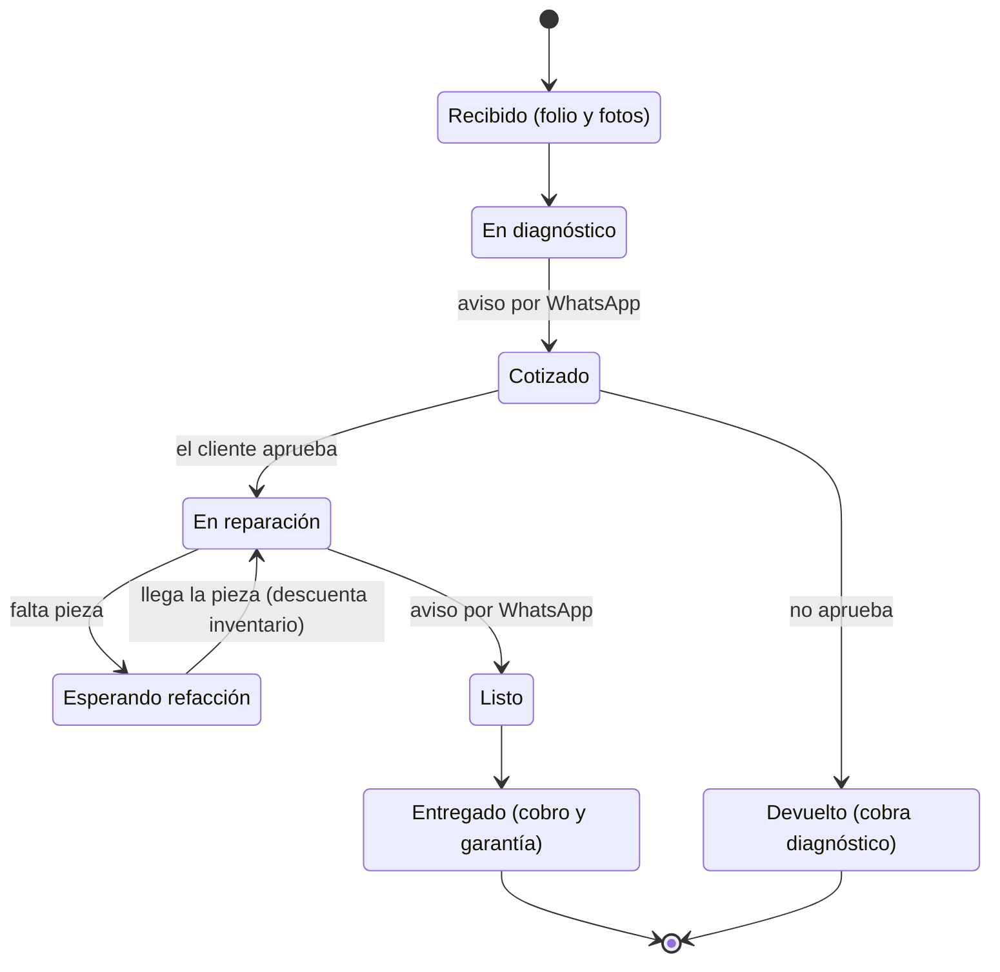

# Diagramas del sistema de punto de venta

Diagramas en Mermaid: GitHub los dibuja automáticamente al abrir este archivo.

## 1. Arquitectura general

## 2. Venta en caja

## 3. Cobro con tarjeta (Mercado Pago Point)

## 4. Modo sin internet y sincronización

## 5. Pedidos por WhatsApp o web

## 6. Corte de caja

## 7. Recomendación de promociones

## 8. Orden de reparación

