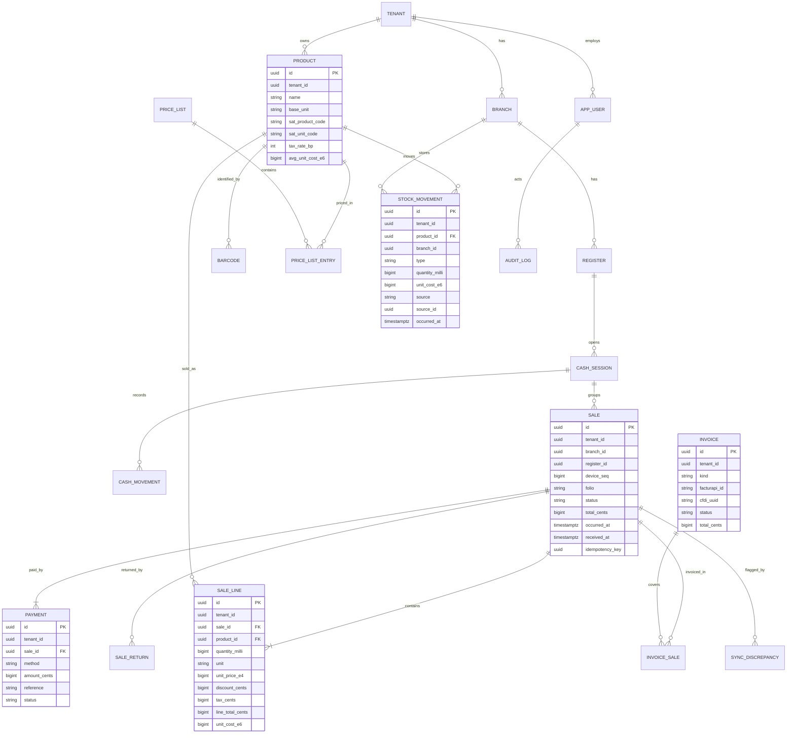
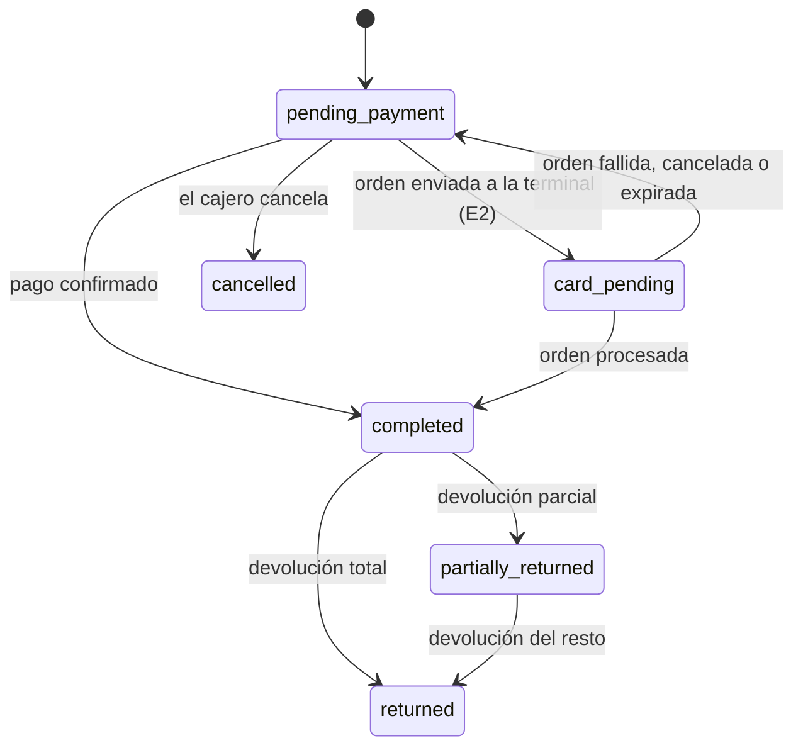

# Modelo de dominio

## Contextos delimitados
Un contexto delimitado (bounded context) es una parte del sistema con su propio lenguaje y sus propias reglas. Cada uno corresponde a un módulo del núcleo.

| Contexto | Responsabilidad | Fase |
| --- | --- | --- |
| `identity` | Negocios, sucursales, cajas, usuarios, roles y PIN | F0 |
| `catalog` | Productos, códigos, unidades, listas de precio y claves SAT | F0 |
| `sales` | Ventas, líneas, devoluciones y folios | E1 |
| `payments` | Pagos, tarjeta tecleada y terminal integrada | E1, E2 |
| `cash` | Sesiones de caja, entradas, salidas y cortes | E1 |
| `inventory` | Libro de movimientos, existencias y costo promedio | E1 |
| `invoicing` | CFDI individual, global, cancelación y egreso | E1 |
| `sync` | Lotes, cursores, idempotencia y discrepancias | E1 |
| `reporting` | Reportes y bitácora | E1 |
| `commerce` | Cotizaciones, apartados, crédito, clientes y lealtad | F2 |
| `purchasing` | Proveedores, órdenes y cuentas por pagar | F2 |
| `repairs` | Órdenes de reparación | F2 |
| `omnichannel` | Pedidos web y por WhatsApp, y reservas | F3 |
| `promotions` | Reglas, evaluación y cupones | F3 |
| `platform` | Alta, planes y API pública | F4 |
| `analytics` | Sugerencias y pronósticos (Python) | F5 |

## Agregados principales
Un agregado (aggregate) es un grupo de objetos que cambia como una unidad y protege sus propias reglas.

| Agregado | Contexto | Contiene | Regla que protege |
| --- | --- | --- | --- |
| `Product` | catalog | `Barcode`, `PriceListEntry`, `UnitConversion` | Un código pertenece a un solo producto por negocio |
| `Sale` | sales | `SaleLine`, `Payment` | Una venta `completed` no se edita; suma de pagos igual al total |
| `Return` | sales | `ReturnLine` | No se devuelve más de lo vendido |
| `CashSession` | cash | `CashMovement`, `CashCount` | Una sola sesión abierta por caja |
| `StockMovement` | inventory | (inmutable) | Nunca se modifica ni se borra |
| `Invoice` | invoicing | `InvoiceSale` | Una venta no se factura dos veces sin el tratamiento correcto |
| `Register` | identity | `RegisterCursor` | Secuencia de dispositivo siempre creciente |
| `RepairOrder` | repairs | `RepairPart`, `RepairPhoto` | Solo transiciones válidas de estado |
| `PromotionRule` | promotions | `RuleAction` | Vigencia y prioridad válidas |

## Objetos de valor
Un objeto de valor (value object) no tiene identidad propia: dos iguales son intercambiables.

| Objeto | Representación | Ejemplo |
| --- | --- | --- |
| `Money` | `amount_cents` entero | `4094` = $40.94 |
| `UnitPrice` | `unit_price_e4` entero | `125000` = $12.50 |
| `UnitCost` | `unit_cost_e6` entero | `153000` = $0.153 |
| `Quantity` | `quantity_milli` entero y `unit` | `3275` metros = 3.275 m |
| `TaxRate` | `rate_bp` entero y tipo (16%, 0%, exento) | `1600` = 16% |
| `Rfc` | texto validado | `XAXX010101000` |
| `Folio` | `register_code-sequence` | `T1-000123` |
| `IdempotencyKey` | UUIDv7 | Generado en la caja |

## Eventos de dominio
Todos llevan `event_id`, `tenant_id`, `occurred_at` y `schema_version`.

| Evento | Se publica cuando | Lo consumen |
| --- | --- | --- |
| `ProductPriceChanged` | Cambia un precio | `sync`, `reporting` |
| `SaleCompleted` | Se confirma una venta | `inventory`, `cash`, `reporting`, `analytics` |
| `SaleCancelled` | Se cancela una venta pendiente | `reporting` |
| `ReturnAuthorized` | Se autoriza una devolución | `inventory`, `invoicing`, `cash` |
| `StockBelowZero` | La existencia queda negativa | Alertas |
| `CashSessionClosed` | Se cierra un corte | `reporting`, notificación por correo |
| `InvoiceIssued` | Se timbra un CFDI | `sales`, `reporting` |
| `GlobalInvoiceIssued` | Se timbra una global | `sales` |
| `SyncDiscrepancyDetected` | La venta no coincide con el servidor | Panel del dueño |
| `CardPaymentResolved` | Una orden llega a estado final (E2) | `sales`, `cash` |

## Invariantes
Una invariante es una regla que siempre debe cumplirse. Estas nunca se rompen:

1. La existencia es la suma de movimientos; `stock_levels` solo es una copia para leer rápido.
2. Los movimientos, las ventas `completed` y la bitácora son inmutables. Se corrige con registros compensatorios.
3. Dinero en enteros con escala explícita; nunca `float` ni `double`.
4. Cantidades con 3 decimales y unidad base explícita.
5. La suma de pagos de una venta `completed` es igual a su total.
6. La venta se guarda antes de cobrar o abrir el cajón.
7. No hay otra forma de pago mientras un cobro integrado no tenga estado final.
8. El servidor nunca rechaza una venta cerrada: registra la discrepancia.
9. Toda operación sincronizada lleva UUIDv7 y llave de idempotencia.
10. Toda tabla de negocio lleva `tenant_id` y RLS.
11. Los datos de tarjeta nunca entran al sistema; solo folio, marca, últimos dígitos si los da el proveedor y resultado.
12. La caja puede vender en efectivo sin internet en cualquier fase.
13. Una venta incluida en una global no vuelve a facturarse sin el tratamiento validado con el contador.

## Diagrama ER (Entrega 1)

## Máquina de estados de la venta

