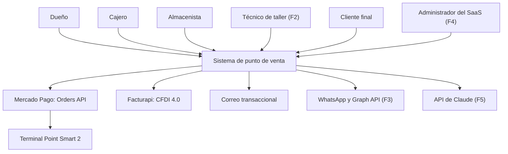
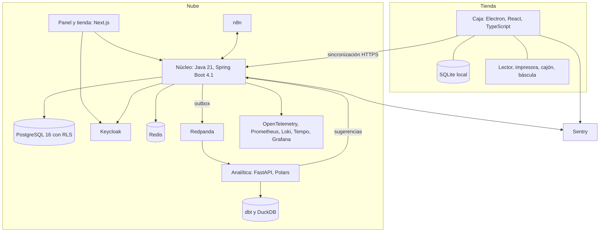
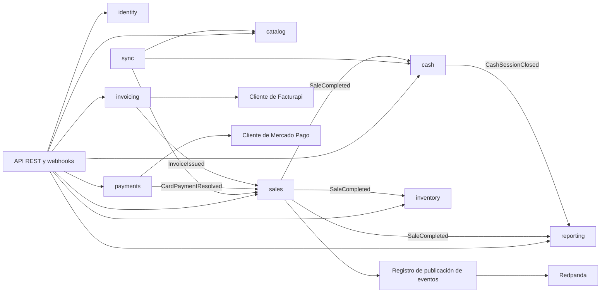

# Arquitectura

Las decisiones de fondo están en [`docs/adr/`](../adr/README.md).

## 1. C4: contexto


## 2. C4: contenedores


## 3. C4: componentes del núcleo

Cada módulo expone una API pública y publica eventos. Spring Modulith verifica en CI que nadie cruce esas fronteras.

## 4. Contratos de API (OpenAPI resumido)
Base: `https://api.<dominio>/api/v1`. El token OIDC define `tenant_id`; la caja usa credenciales de dispositivo. Las escrituras llevan `Idempotency-Key`. Los errores usan `application/problem+json`.

| Método y ruta | Uso | Respuesta | Fase |
| --- | --- | --- | --- |
| `POST /registers/enroll` | Registrar una caja | Credenciales de dispositivo | F0 |
| `GET, POST /products` | Consultar y crear productos | Página de productos | F0 |
| `PATCH /products/{id}` | Editar un producto | Producto | F0 |
| `POST /imports/catalog` | Importar un CSV | Reporte por fila | F0 |
| `POST /price-changes` | Cambio masivo de precios | Resumen | F0 |
| `POST /sync/push` | Subir lote de la caja | Estado por operación | E1 |
| `GET /sync/pull?cursor=` | Bajar cambios | Cambios y nuevo cursor | E1 |
| `GET /discrepancies` | Ver discrepancias | Lista | E1 |
| `POST /invoices` | Factura individual | Factura | E1 |
| `POST /invoices/global` | Factura global de un periodo | Factura | E1 |
| `POST /invoices/{id}/cancel` | Cancelar | Estado | E1 |
| `GET /reports/sales` | Reporte de ventas | Agregados | E1 |
| `POST /card-orders` | Crear orden en la terminal | Orden | E2 |
| `GET /card-orders/{id}` | Consulta puntual | Estado | E2 |
| `POST /card-orders/{id}/cancel` | Pedir cancelación | 202 y estado | E2 |
| `POST /webhooks/mercadopago` | Aviso de Mercado Pago | 200 rápido | E2 |
| `GET /registers/{id}/events` | Avisos en tiempo real (SSE) | Flujo de eventos | E2 |

## 5. Sincronización sin internet
La venta se guarda primero en SQLite, junto con una fila en `sync_outbox`, dentro de la misma transacción.

### Push
Cada 5 segundos, o al recuperar la conexión, se envía un lote de hasta 100 operaciones en orden de `device_seq`:
```json
{
  "registerId": "0193...",
  "operations": [{
    "opId": "0193...",
    "deviceSeq": 1042,
    "type": "sale.completed",
    "schemaVersion": 1,
    "occurredAt": "2026-12-10T18:21:04Z",
    "payload": {}
  }]
}
```
La respuesta da un estado por operación: `accepted`, `duplicate` o `quarantined`. `opId` es la llave de idempotencia y tiene índice único por negocio. Una operación con formato inválido queda en cuarentena para revisión: nunca se pierde y no bloquea a las siguientes.

### Pull
La caja envía su último `cursor`, una secuencia global de cambios por negocio, y recibe hasta 500 cambios de catálogo, precios, usuarios, permisos y configuración. Los aplica y guarda el cursor en la misma transacción.

### Resolución de conflictos
| Dato | Quién manda | Ejemplo |
| --- | --- | --- |
| Venta cerrada | La caja | Se acepta aunque el precio haya cambiado; se registra discrepancia |
| Movimientos | Se suman | Dos cajas venden el último rollo: queda en -1 y se genera alerta |
| Catálogo y precios | El servidor | Reemplazan la copia local |
| Usuarios y permisos | El servidor | La baja aplica al sincronizar |
| Sesión de caja | La caja | El servidor valida y marca diferencias |
| Costo promedio | El servidor | Lo calcula en orden de recepción y corrige reportes |

### Reloj y versiones
- El orden lo da `device_seq`, no el reloj. `occurred_at` es informativo, y se marca si difiere mucho de `received_at`.
- El servidor acepta la versión actual del protocolo y la anterior, y avisa a las cajas viejas.

## 6. Mercado Pago Point (Entrega 2)
Hasta la Entrega 2, la terminal queda en su modo normal y el cajero captura el folio.

1. **Spike previo.** Con la terminal real, comprobar si en modo PDV acepta cobros tecleados y cómo volver a `STANDALONE`. La [configuración documentada](https://www.mercadopago.com.mx/developers/en/docs/mp-point/configure-terminal.md) cubre el cambio a PDV con `PATCH /terminals/v1/setup` y reinicio, pero no responde esas dos dudas.
2. **Cobro.** La caja llama a `POST /card-orders`, y el núcleo crea la orden en `POST /v1/orders` con `X-Idempotency-Key`. La venta pasa a `card_pending`.
3. **Resultado.** El webhook de `orders` se valida con `x-signature` y responde en menos de 22 segundos. El núcleo avisa a la caja por SSE.
4. **Sin aviso.** Como los reintentos son cada 15 minutos, si pasan 30 segundos sin resultado, la caja pide una consulta puntual de `GET /v1/orders/{id}`, sin hacer sondeo continuo.
5. **Cancelación.** `POST /v1/orders/{id}/cancel` con `x-allow-cancelable-status: at_terminal` responde 202 y es asíncrona. Solo el webhook confirma: la terminal puede terminar un pago ya en curso.
6. **Expiración.** Se usa `expiration_time` de 2 minutos para acotar la espera, frente a los 15 minutos por defecto en PDV.
7. **Reembolso.** `POST /v1/orders/{id}/refund`, total o parcial, hasta 90 días.
8. **Pruebas.** En CI se usan un cliente falso y el [simulador de estados](https://www.mercadopago.com.mx/developers/en/docs/mp-point/integration-test.md) con dispositivo virtual. Antes de producción, un cobro real pequeño con reembolso, porque las cuentas de prueba no procesan pagos reales.

Cada negocio tendrá sus propias credenciales cifradas (RF-080). En la Entrega 2 solo existen las de la tienda.

## 7. Facturapi
- **Una organización por negocio.** Su llave secreta se guarda cifrada por `tenant_id`, nunca en el repositorio. Se usa `sk_test_*` hasta tener CSD.
- **Requisitos.** [Datos fiscales, CSD y carta manifiesto](https://docs.facturapi.io/docs/getting-started/organization-onboarding/) antes de emitir en producción.
- **Factura individual.** La venta debe estar sincronizada, con claves SAT completas e IVA incluido. Se llama en un proceso con reintentos e idempotencia.
- **Factura global.** La [referencia de API](https://docs.facturapi.io/api/) documenta un objeto `global` en `POST /invoices`. Falta probarlo. La periodicidad se define con el contador.
- **Invariante.** `invoice_state` de la venta: `not_invoiced`, `individual` o `in_global`.
- **Autofactura.** Fase 2, con portal propio sobre la API, porque el producto de [e-receipts](https://www.facturapi.io/pricing) cuesta $599 al mes más $0.40 por recibo.

## 8. Multi-tenant con RLS
```sql
ALTER TABLE sale ENABLE ROW LEVEL SECURITY;
ALTER TABLE sale FORCE ROW LEVEL SECURITY;
CREATE POLICY tenant_isolation ON sale
  USING (tenant_id = current_setting('app.tenant_id', true)::uuid)
  WITH CHECK (tenant_id = current_setting('app.tenant_id', true)::uuid);
```
- Un aspecto de Spring ejecuta `SET LOCAL app.tenant_id` al abrir cada transacción, a partir del token.
- Roles separados: `app_runtime` sin `BYPASSRLS`, `app_migrator` para Flyway y `app_admin` auditado.
- Una prueba en CI recorre `information_schema`, exige la política en cada tabla con `tenant_id` y prueba el acceso cruzado.

## 9. Motor de promociones (fase 3)
```json
{
  "id": "0193...",
  "name": "3x2 en clavo",
  "priority": 10,
  "stackable": false,
  "validFrom": "2027-05-01T00:00:00-06:00",
  "validUntil": "2027-05-31T23:59:59-06:00",
  "condition": { "==": [{ "var": "line.categoryCode" }, "nails"] },
  "action": { "type": "buy_x_get_y", "buy": 3, "pay": 2, "applyTo": "lowest_price" }
}
```
La condición se evalúa con JSON Logic en TypeScript y en Java. El reparto de la acción está escrito en ambos lenguajes y los casos compartidos están en `packages/contracts`. El servidor revalida y registra discrepancias, sin anular ventas cerradas.

## 10. Hardware
| Equipo | Interfaz | Implementación | Notas |
| --- | --- | --- | --- |
| Lector USB | Teclado HID | Campo con detección de ráfaga | Distingue escaneo de tecleo por la velocidad |
| Impresora TM-T20 | `PrinterProvider` | ESC/POS en bytes crudos hacia la cola de Windows | Se valida en cuanto llegue; un falso guarda los bytes para pruebas |
| Cajón RJ11 | `CashDrawer` | Comando `ESC p` por la impresora | Se abre después de guardar la venta |
| Báscula Rhino BAR-7 | `ScaleProvider` | `ManualScaleProvider` | Sin puerto de datos: captura manual con confirmación |
| Etiquetas | `LabelPrinter` | PDF en F0 | La 3nStar RPT001 aparece como impresora de tickets; no comprar hasta definir modelo |
| Terminal | `CardTerminal` | `ManualTerminal` en E1, `MercadoPagoTerminal` en E2 | La tarjeta nunca toca el sistema |

```ts
/** Reads a weight in thousandths of the base unit. */
export interface ScaleProvider {
  readWeightMilli(): Promise<number>;
}
```
**Captura manual de peso.** Teclear 125 en lugar de 1.25 kg es un error caro. La caja pide confirmar cuando el peso supera un límite por producto y muestra el importe antes de agregar la línea.
